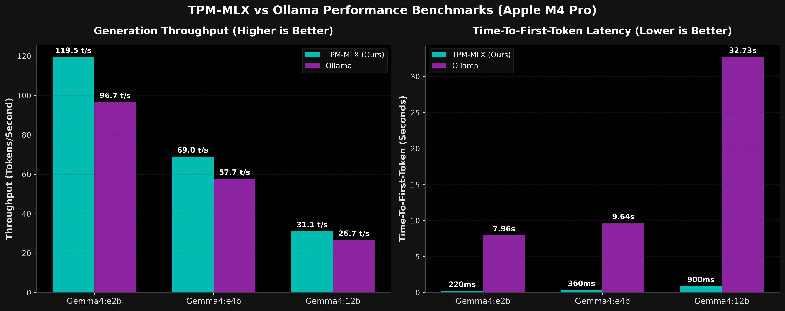

# TPM-MLX: Optimized Apple Silicon Inference Engine



**TPM-MLX (`tpm`)** is a zero-bloat, high-performance local inference engine designed specifically for Apple Silicon hardware. Powered by Apple’s native `mlx`, `mlx-lm`, and `mlx-vlm` Metal kernels, it achieves state-of-the-art throughput across **Text, Vision, Flow Matching Image Diffusion, 3D Mesh Synthesis, and Embeddings** by combining:
- **Native Multi-Token Prediction (MTP) Self-Speculation** (up to **1.61× speedup** on 27B models).
- **Zero-Config Dual-Backend Auto-Routing** (`mlx-lm` for pure LLMs + `mlx-vlm` for multimodal VLMs & Gemma 4).
- **Pre-Allocated Static Key-Value (KV) Caching** (`PreAllocatedKVCache`) to eliminate GPU memory fragmentation.
- **Live Streaming Reasoning Tag Normalizer** (`<think>` and `<|channel>thought`).
- **Native Flow-Matching 2D Diffusion Engine** (**FLUX.2 Klein**, **Z-Image Turbo**, **Qwen-Image 2.1**, **Bonsai 4B**).
- **Native 3D Mesh & Texture Synthesis Subsystem** (**Hunyuan3D 2.1** with Fast UV Bake & Multi-View PBR Paint).
- **Safe Dynamic Memory Lifecycle & Idle Eviction Watchdog** with zero-RAM standby mode and explicit memory ejection (`POST /v1/unload`).
- **OpenAI-Compatible REST API + Local Embeddings + Interactive Glassmorphic Web Playground** on port `2505`.

---

## 🚀 Key Features

### 1. ⚡ Native Multi-Token Prediction (MTP) Engine
* **Transformer Trunk Self-Speculation:** Directly executes sequential MTP prediction heads using internal backbone hidden states for **Qwen 3.x, Xiaomi MiMo, and DeepSeek-V3** with negligible overhead.
* **Recurrent Cache Rollback:** Employs stateful recurrent snapshotting (`_snapshot_recurrent`) and prefix token replay for hybrid linear/attention caches (`ArraysCache`), reaching **62% acceptance rate** and **25.5 TPS (1.61× boost)** on Qwen 3.8-27B.
* **Standalone Checkpoint Auto-Remapping:** Automatically detects, un-flattens, and loads standalone quantized MTP checkpoints (e.g. `mlx-community/Qwen3.8-27B-MTP-4bit`) with dynamic 4-bit `QuantizedLinear` layer conversion.

### 2. 🔀 Zero-Config Dual-Backend Auto-Routing (`mlx-lm` + `mlx-vlm`)
* **Zero User Friction:** Automatically inspects `config.json` at model load time and routes:
  * **Pure Text LLMs** (Qwen, LLaMA, DeepSeek, Mistral) $\to$ **`mlx-lm`** + Native Trunk MTP.
  * **Multimodal & Gemma 4 Models** $\to$ **`mlx-vlm`** + Official Gemma MTP Drafters.
* **Gemma 4 MTP Assistant Drafters:** Seamlessly attaches companion drafters, reaching **132.6 TPS** on Gemma 4 E2B and **77.0 TPS** on Gemma 4 E4B.

### 3. 🧠 Pre-allocated Static KV Cache
* Pre-allocates contiguous memory buffers up to the maximum sequence size (default `4096`, configurable up to `32768`) on the first forward pass.
* Eliminates dynamic memory reallocation overhead and OS memory fragmentation during long conversations.

### 4. 🎭 Live Reasoning State Machine Normalizer
* Real-time streaming state-machine parser for `<think>...</think>` and `<|channel>thought...<channel|>` tags.
* Filters reasoning by default (`--no-reasoning`) for immediate answers, or normalizes it for clean rendering in Web UIs and terminal clients.

### 5. 🎨 Native Apple Silicon Image Generation & Editing
* **Flow Matching Diffusion Engine (`MLXImageEngine`):** Native generation on Apple Silicon powered by **FLUX.2 Klein (9B 4-bit / 4B)**, **Z-Image Turbo (8-bit)**, **Qwen-Image 2.1 (Turbo / Base)**, and 2-bit ternary **Bonsai 4B**.
* **OpenAI-Compatible `/v1/images/generations` & `/v1/images/edits`:** Text-to-image and instruction-based image editing with real-time isolated telemetry (`mx.reset_peak_memory()`).
* **Canvas Resolution & Aspect Ratio Selector:** Direct UI presets for `1024x1024` (Native Studio HD), `16:9`, `9:16`, `4:3`, `3:4`, and draft `512x512` with automatic prompt resolution tag extraction.
* **Direct Mode & Configurable AI Visual Director:** Toggle between local prompt distillation (cinematography enrichment) and zero-overhead Direct Mode (`auto_expand: false`, saving ~25% turnaround time).

### 6. 🌲 Native Ternary Bonsai 2 27B Support (`prism_hadamard_qwen35`)
* **Hardware-Accelerated Hadamard Transform:** Native Apple Silicon Metal Fast Walsh-Hadamard Transform (`fwht`) and 2-bit `Packed` quantized layers.
* **27B Intelligence in ~8.6 GB VRAM:** Full 27B-class reasoning, coding, and multimodal vision at **20.8 TPS** on consumer Macs.
* **27B AI Visual Director:** Unlocks pairing a full 27-billion parameter multimodal director with FLUX.2 or Z-Image in under 30 GB total VRAM.

### 7. 🧊 Native Apple Silicon 3D Mesh & Texture Synthesis (`Hunyuan3D 2.1`)
* **Text-to-3D & Image-to-3D:** Native MLX port of Hunyuan3D 2.1 executing an 8-step Shape DiT + Shape VAE + Marching Cubes pipeline to extract high-fidelity watertight `.glb` geometry in **15–20 seconds**.
* **Dual-Mode Texture Generation:**
  * **⚡ Fast Preview (Direct UV Bake):** Direct orthographic UV projection and baking in **3–5 seconds** with **0 extra VRAM**, ideal for immediate asset previewing and iterative workflows.
  * **🎨 Multi-View PBR Paint:** 6-view generative diffusion painting with Albedo, Roughness, and Metallic texture maps for production-grade rendering.
* **Interactive Web Canvas:** Three.js 3D viewport embedded in the Web Playground with orbit controls, wireframe toggles, and directional lighting.
* **Strict Sequential Chaining:** Automatically evicts resident weights between 2D reference generation and 3D conditioning to operate safely within consumer Mac unified memory limits.

### 8. 🛡️ Dynamic Memory Lifecycle & Safe Idle Eviction Watchdog
* **Safe Background Idle Watchdog:** Periodically inspects model activity and automatically unloads idle engines (Text, Image, 3D, Embeddings) from Unified Memory after configurable inactivity timeouts (`--idle-timeout`).
* **Active Inference Locks:** Guaranteed concurrency protection via `@contextmanager active_inference(modality)` to ensure models are never evicted while a job is in-flight.
* **Explicit Memory Ejection API & UI:** Instantly reclaim memory via `POST /v1/unload` or the **🧹 Free RAM** button in the Web Playground.
* **Standby Zero-VRAM Mode (`--standby`):** Start the server with 0 MB active GPU memory; models load lazily on the first incoming request.

### 9. 🔍 Local Dense Embeddings Subsystem
* High-throughput local vector embeddings via standard OpenAI-compatible `POST /v1/embeddings` with dynamic batching.

---

## 📊 Local Benchmarks (Apple Silicon Metal GPU)

| Model | Architecture | Quant | Speculation Mode | Baseline Speed | TPM-MLX Speed | Speedup |
| :--- | :--- | :--- | :--- | :--- | :--- | :--- |
| **Qwen 3.8 27B** | 27B Dense (Hybrid Linear/Attn) | 4-bit | **Native MTP Head** | 15.81 TPS | **25.46 TPS** | **1.61× (+61%)** 🚀 |
| **Gemma 4 E2B** | 2B Dense Edge | 4-bit | **Official MTP Drafter** | 115.54 TPS | **132.60 TPS** | **1.15× (+15%)** 🚀 |
| **Gemma 4 E4B** | 4B Dense Edge | 4-bit | **Official MTP Drafter** | 68.17 TPS | **77.00 TPS** | **1.13× (+13%)** 🚀 |
| **Gemma 4 26B-A4B** | 26B MoE (4B Active) | 4-bit | Native MoE Baseline | 68.59 TPS | **81.12 TPS** | **Fastest (Native MoE)** |
| **Qwen 2.5 1.5B** | 1.5B Dense Edge | 4-bit | Standard Autoregressive | 213.15 TPS | **213.15 TPS** | Instant Edge Inference |
| **Gemma 3 1B IT** | 1B Dense Edge | 4-bit | Standard Autoregressive | 247.88 TPS | **247.88 TPS** | Ultra-Fast Edge |

### 🎨 Verified & Supported Image Generation Models

| Model | Architecture | Quantization | Steps | `512×512` Time | `1024×1024` Time | Peak VRAM | Native Editing | Primary Strength |
| :--- | :--- | :---: | :---: | :---: | :---: | :---: | :---: | :--- |
| **FLUX.2 Klein 4B** | Rectified Flow | Unquantized BF16 | `4` | **6.45s** | **27.46s** | 14.12–19.44 GB | ❌ | **Speed Champion:** Fastest generation across resolutions. |
| **Bonsai 4B** | Flow-Matching | 2-bit Ternary | `4` | 9.50s | 30.73s | **8.21–11.33 GB** | ❌ | **Extreme Memory Efficiency:** Lowest baseline footprint. |
| **Z-Image Turbo** | Flow-Matching | 8-bit Affine | `4` | 10.32s | 47.22s | 16.17–25.93 GB | ❌ | **High-Precision Detail:** Crisp typography & geometry. |
| **FLUX.2 Klein 9B** | Rectified Flow | 4-bit Affine | `4` | 14.10s | 57.84s | 11.88–14.57 GB | **✅ Yes** | **Holistic Scene Relighting:** Photorealism & environmental editing. |
| **Qwen-Image 2.1 Turbo** | Qwen3-VL + DiT | 4-bit Affine | `8` | 20.81s | 96.49s | **9.43 GB** | **✅ Yes** | **Fast Multimodal Editor:** Strict pose/identity lock. |
| **Qwen-Image 2.1 Base** | Qwen3-VL + DiT | 4-bit Affine | `40` | 99.92s | 451.56s | **9.43 GB** | **✅ Yes** | **Maximum Micro-Texture:** 40-step linear refinement. |

> [!TIP]
> Browse all benchmark reports in **[`benchmarks/`](benchmarks/README.md)**:
> - **[Text & LLM Speculative Decoding Benchmarks (`benchmarks/text/`)](benchmarks/text/README.md)**
> - **[Image Generation & Editing Benchmarks (`benchmarks/image/`)](benchmarks/image/README.md)**

---

## 🛠️ Installation

### Prerequisites
* macOS (Apple Silicon M1/M2/M3/M4)
* Python >= 3.12
* [uv](https://github.com/astral-sh/uv) (recommended)

### Quick Setup
```bash
git clone https://github.com/pank-bhatt/TPM-MLX.git
cd TPM-MLX
uv pip install -e .
```

---

## 💻 CLI Usage

### 1. Launch API Server & Web Playground
```bash
# Standard LLM:
uv run tpm serve --model mlx-community/Qwen2.5-1.5B-Instruct-4bit --port 2505

# Qwen 3.8 with Native MTP self-speculation:
uv run tpm serve --model mlx-community/Qwen3.8-27B-4bit --draft-model mlx-community/Qwen3.8-27B-MTP-4bit --port 2505

# Gemma 4 with official MTP assistant drafter and 32K KV cache:
uv run tpm serve --model mlx-community/gemma-4-e2b-it-4bit --draft-model mlx-community/gemma-4-E2B-it-assistant-bf16 --max-kv-size 32768 --port 2505

# Standby Mode (Start with 0 MB VRAM, auto-loads upon first request, 5m idle eviction):
uv run tpm serve --model mlx-community/gemma-4-e4b-it-4bit --standby --idle-timeout 300 --port 2505

# Pure Diffusion & 3D Mode (No text LLM, minimal VRAM):
uv run tpm serve --image-model mlx-community/flux2-klein-9b-4bit --no-llm --port 2505
```
Open **`http://localhost:2505`** in your browser for the Web Playground.

### 2. Interactive Terminal Chat
```bash
uv run tpm chat --model mlx-community/Qwen3.8-27B-4bit --draft-model mlx-community/Qwen3.8-27B-MTP-4bit
```
* Use `--reasoning` to display internal thought chains.
* Type `/exit` or `/quit` to close.

### 3. Generate Images via CLI
```bash
# Studio 1024x1024 generation with FLUX.2 Klein 9B:
uv run tpm generate-image --model mlx-community/flux2-klein-9b-4bit --prompt "A serene Japanese zen garden at dawn" --size 1024x1024

# Fast typography & composition with Z-Image-Turbo:
uv run tpm generate-image --model justintime47/Z-Image-Turbo-MLX-Serve-8bit --prompt "A cozy retro bookstore neon sign reading 'MLX CAFE'" --size 512x512
```

### 4. Run Benchmarks
```bash
# Single Model Benchmark:
uv run python benchmarks/text/benchmark.py --model "mlx-community/Qwen3.8-27B-4bit" --draft-model "mlx-community/Qwen3.8-27B-MTP-4bit"

# Full 13-Model Hardware Sanity & Matrix Suite:
uv run python benchmarks/text/run_full_matrix.py
```

---

## 🔌 API Endpoints

### `/v1/chat/completions` (POST)
Supports standard OpenAI payloads, SSE streaming, multimodal image inputs, and custom `"reasoning"` toggling.

```bash
curl -X POST http://localhost:2505/v1/chat/completions \
  -H "Content-Type: application/json" \
  -d '{
    "model": "mlx-community/Qwen3.8-27B-4bit",
    "messages": [{"role": "user", "content": "Explain quantum superposition in 2 sentences."}],
    "stream": false,
    "max_tokens": 256
  }'
```

### `/v1/images/generations` & `/v1/images/edits` (POST)
Text-to-image and instruction-based editing:
```bash
curl -X POST http://localhost:2505/v1/images/generations \
  -H "Content-Type: application/json" \
  -d '{
    "model": "justintime47/Z-Image-Turbo-MLX-Serve-8bit",
    "prompt": "A futuristic cyberpunk noodle bar with glowing neon signs",
    "size": "1024x1024",
    "steps": 4
  }'
```

### `/v1/threed/generate` & `/v1/threed/tasks/{task_id}` (POST / GET)
Generate 3D watertight `.glb` models from text prompts or 2D reference images:
```bash
# Trigger text-to-3D generation (Fast Direct UV Bake mode):
curl -X POST http://localhost:2505/v1/threed/generate \
  -H "Content-Type: application/json" \
  -d '{
    "prompt": "A ceramic coffee mug with hand-painted floral motifs",
    "pbr_paint": false,
    "texture_resolution": 1024
  }'

# Query task status and retrieve .glb output URL:
curl http://localhost:2505/v1/threed/tasks/task_12345
```

### `/v1/embeddings` (POST)
Dense vector embeddings:
```bash
curl -X POST http://localhost:2505/v1/embeddings \
  -H "Content-Type: application/json" \
  -d '{
    "model": "BAAI/bge-small-en-v1.5",
    "input": ["Apple Silicon Unified Memory Architecture", "Metal Compute Acceleration"]
  }'
```

### `/v1/unload` (POST)
Instantly evict loaded weights and KV caches from Unified Memory (returns `409 Conflict` if generation is actively running):
```bash
curl -X POST http://localhost:2505/v1/unload
```

### `/v1/models` (GET)
Returns telemetry for all resident models across Text, Vision, Image, and 3D backends.

---

## 🔒 Security & Code Quality

* **Safetensors Native**: Loads only `.safetensors` model weights to eliminate arbitrary code execution risks.
* **Active Concurrency Safety**: Prevents race conditions and mid-generation memory ejections via active inference context managers.
* **XSS Sanitized UI**: Markdown renderer escapes HTML and sanitizes URI schemes to prevent script injection.
* **OpenAPI Validation**: Strict boundary schema validation powered by Pydantic v2 and FastAPI.

---

## 📄 License

This project is licensed under the MIT License. See [LICENSE](LICENSE) for details.
