# TPM-MLX Image Generation & Editing Benchmark Report

**Date:** 2026-10-13  
**Platform:** Apple Silicon (64 GB Unified Memory, macOS)  
**Common Baseline Prompt:** *"Generate a natural looking and photo-realistic image of a football player playing football in a field"*  
**Fixed Seed:** `42` | **Modes:** `🪄 With AI Director` (Gemma 4 E2B + MTP) vs. `⚡ Direct (No Director)`

---

## Executive Summary: Text-to-Image Leaderboard (24 Runs Across 6 Models)

| Model | Quantization | Steps | Configuration | Resolution | Generation Time | Step Time | Peak RAM / VRAM | Generated Output |
| :--- | :---: | :---: | :--- | :---: | :---: | :---: | :---: | :--- |
| **Bonsai 4B** | 2-bit Ternary | `4` | 🪄 With AI Director | `512x512` | **9.50s** | `2.38s` | **8.57 GB** | [`bonsai_4b_2bit_with_director_512.png`](images/bonsai_4b_2bit_with_director_512.png) |
| **Bonsai 4B** | 2-bit Ternary | `4` | 🪄 With AI Director | `1024x1024` | **30.73s** | `7.68s` | **11.33 GB** | [`bonsai_4b_2bit_with_director_1024.png`](images/bonsai_4b_2bit_with_director_1024.png) |
| **Bonsai 4B** | 2-bit Ternary | `4` | ⚡ Direct (No Director) | `512x512` | **9.50s** | `2.38s` | **12.16 GB** | [`bonsai_4b_2bit_without_director_512.png`](images/bonsai_4b_2bit_without_director_512.png) |
| **Bonsai 4B** | 2-bit Ternary | `4` | ⚡ Direct (No Director) | `1024x1024` | **31.26s** | `7.82s` | **8.21 GB** | [`bonsai_4b_2bit_without_director_1024.png`](images/bonsai_4b_2bit_without_director_1024.png) |
| **FLUX.2 Klein 9B** | 4-bit Affine | `4` | 🪄 With AI Director | `512x512` | **14.76s** | `3.69s` | **11.88 GB** | [`flux2_klein_9b_4bit_with_director_512.png`](images/flux2_klein_9b_4bit_with_director_512.png) |
| **FLUX.2 Klein 9B** | 4-bit Affine | `4` | 🪄 With AI Director | `1024x1024` | **60.79s** | `15.20s` | **14.57 GB** | [`flux2_klein_9b_4bit_with_director_1024.png`](images/flux2_klein_9b_4bit_with_director_1024.png) |
| **FLUX.2 Klein 9B** | 4-bit Affine | `4` | ⚡ Direct (No Director) | `512x512` | **14.10s** | `3.53s` | **13.70 GB** | [`flux2_klein_9b_4bit_without_director_512.png`](images/flux2_klein_9b_4bit_without_director_512.png) |
| **FLUX.2 Klein 9B** | 4-bit Affine | `4` | ⚡ Direct (No Director) | `1024x1024` | **57.84s** | `14.46s` | **12.16 GB** | [`flux2_klein_9b_4bit_without_director_1024.png`](images/flux2_klein_9b_4bit_without_director_1024.png) |
| **Z-Image Turbo** | 8-bit Affine | `4` | 🪄 With AI Director | `512x512` | **10.32s** | `2.58s` | **16.17 GB** | [`z_image_turbo_8bit_with_director_512.png`](images/z_image_turbo_8bit_with_director_512.png) |
| **Z-Image Turbo** | 8-bit Affine | `4` | 🪄 With AI Director | `1024x1024` | **47.22s** | `11.81s` | **25.93 GB** | [`z_image_turbo_8bit_with_director_1024.png`](images/z_image_turbo_8bit_with_director_1024.png) |
| **Z-Image Turbo** | 8-bit Affine | `4` | ⚡ Direct (No Director) | `512x512` | **11.69s** | `2.92s` | **16.17 GB** | [`z_image_turbo_8bit_without_director_512.png`](images/z_image_turbo_8bit_without_director_512.png) |
| **Z-Image Turbo** | 8-bit Affine | `4` | ⚡ Direct (No Director) | `1024x1024` | **47.69s** | `11.92s` | **25.93 GB** | [`z_image_turbo_8bit_without_director_1024.png`](images/z_image_turbo_8bit_without_director_1024.png) |
| **FLUX.2 Klein 4B** | Unquantized BF16 | `4` | 🪄 With AI Director | `512x512` | **7.41s** | `1.85s` | **14.12 GB** | [`flux2_klein_4b_bf16_with_director_512.png`](images/flux2_klein_4b_bf16_with_director_512.png) |
| **FLUX.2 Klein 4B** | Unquantized BF16 | `4` | 🪄 With AI Director | `1024x1024` | **27.87s** | `6.97s` | **19.44 GB** | [`flux2_klein_4b_bf16_with_director_1024.png`](images/flux2_klein_4b_bf16_with_director_1024.png) |
| **FLUX.2 Klein 4B** | Unquantized BF16 | `4` | ⚡ Direct (No Director) | `512x512` | **6.45s** | `1.61s` | **19.29 GB** | [`flux2_klein_4b_bf16_without_director_512.png`](images/flux2_klein_4b_bf16_without_director_512.png) |
| **FLUX.2 Klein 4B** | Unquantized BF16 | `4` | ⚡ Direct (No Director) | `1024x1024` | **27.46s** | `6.86s` | **14.53 GB** | [`flux2_klein_4b_bf16_without_director_1024.png`](images/flux2_klein_4b_bf16_without_director_1024.png) |
| **Qwen-Image 2.1 Turbo** | 4-bit Affine | `8` | 🪄 With AI Director | `512x512` | **20.81s** | `2.60s` | **9.43 GB** | [`qwen21_turbo_4bit_with_director_512.png`](images/qwen21_turbo_4bit_with_director_512.png) |
| **Qwen-Image 2.1 Turbo** | 4-bit Affine | `8` | 🪄 With AI Director | `1024x1024` | **96.49s** | `12.06s` | **9.43 GB** | [`qwen21_turbo_4bit_with_director_1024.png`](images/qwen21_turbo_4bit_with_director_1024.png) |
| **Qwen-Image 2.1 Turbo** | 4-bit Affine | `8` | ⚡ Direct (No Director) | `512x512` | **32.66s** | `4.08s` | **9.43 GB** | [`qwen21_turbo_4bit_without_director_512.png`](images/qwen21_turbo_4bit_without_director_512.png) |
| **Qwen-Image 2.1 Turbo** | 4-bit Affine | `8` | ⚡ Direct (No Director) | `1024x1024` | **99.11s** | `12.39s` | **9.43 GB** | [`qwen21_turbo_4bit_without_director_1024.png`](images/qwen21_turbo_4bit_without_director_1024.png) |
| **Qwen-Image 2.1 Base** | 4-bit Affine | `40` | 🪄 With AI Director | `512x512` | **99.92s** | `2.50s` | **9.43 GB** | [`qwen21_base_4bit_with_director_512.png`](images/qwen21_base_4bit_with_director_512.png) |
| **Qwen-Image 2.1 Base** | 4-bit Affine | `40` | 🪄 With AI Director | `1024x1024` | **451.56s** | `11.29s` | **9.43 GB** | [`qwen21_base_4bit_with_director_1024.png`](images/qwen21_base_4bit_with_director_1024.png) |
| **Qwen-Image 2.1 Base** | 4-bit Affine | `40` | ⚡ Direct (No Director) | `512x512` | **107.03s** | `2.68s` | **9.43 GB** | [`qwen21_base_4bit_without_director_512.png`](images/qwen21_base_4bit_without_director_512.png) |
| **Qwen-Image 2.1 Base** | 4-bit Affine | `40` | ⚡ Direct (No Director) | `1024x1024` | **455.90s** | `11.40s` | **9.43 GB** | [`qwen21_base_4bit_without_director_1024.png`](images/qwen21_base_4bit_without_director_1024.png) |

---

## Detailed Model-by-Model Analysis

### 1. Bonsai 4B (2-bit Ternary)

- **Hugging Face Repository:** `prism-ml/bonsai-image-ternary-4B-mlx-2bit`

#### With AI Director (512x512)
- **Generation Time:** `9.50s` (Step Rate: `2.375s/step`)
- **Peak Unified Memory:** `8.57 GB`
- **AI Visual Director Expanded Prompt:**
  > "Hyperrealistic action shot of a determined football player mid-play on a lush, sun-drenched green field. Golden hour sunlight flares through stadium haze, casting long shadows. Sweat glistens on the player's jersey. Shallow depth of field, cinematic grading, ultra-detailed, 8k, shot on Arri Alexa."

#### With AI Director (1024x1024)
- **Generation Time:** `30.73s` (Step Rate: `7.684s/step`)
- **Peak Unified Memory:** `11.33 GB`
- **AI Visual Director Expanded Prompt:**
  > "Hyperrealistic action shot of a determined football player mid-play on a vibrant green grass field. Golden hour sunlight casts long shadows, illuminating dust motes in the crisp, warm air. Intense focus, sweat glistening, dramatic low-angle composition. Cinematic, ultra-detailed, 8k photography."

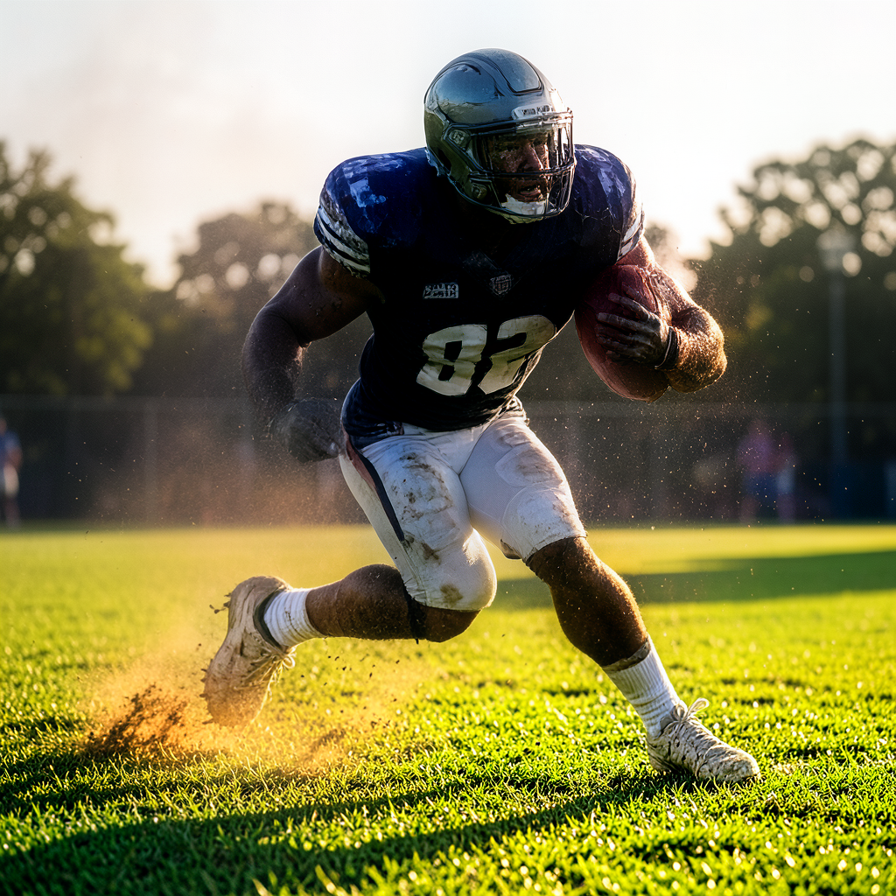

#### Without AI Director (512x512)
- **Generation Time:** `9.50s` (Step Rate: `2.375s/step`)
- **Peak Unified Memory:** `12.16 GB`
- **Prompt:** *Raw Direct Prompt*

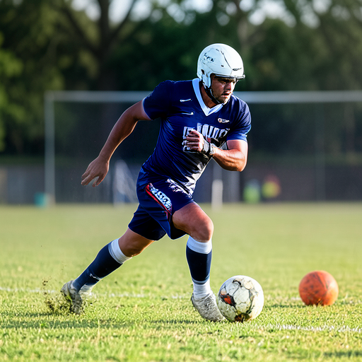

#### Without AI Director (1024x1024)
- **Generation Time:** `31.26s` (Step Rate: `7.816s/step`)
- **Peak Unified Memory:** `8.21 GB`
- **Prompt:** *Raw Direct Prompt*

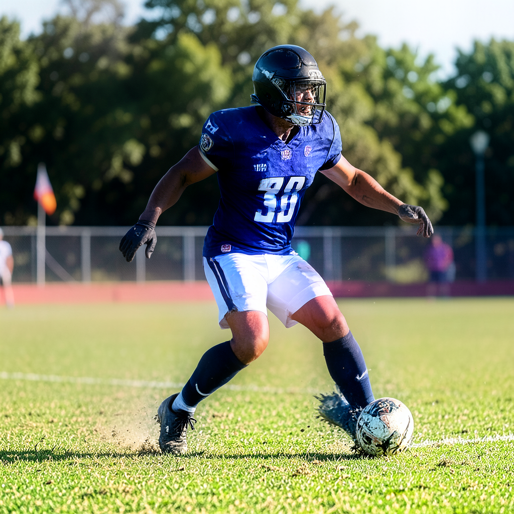

---

### 2. FLUX.2 Klein 9B (4-bit Affine)

- **Hugging Face Repository:** `mlx-community/flux2-klein-9b-4bit`

#### With AI Director (512x512)
- **Generation Time:** `14.76s` (Step Rate: `3.691s/step`)
- **Peak Unified Memory:** `11.88 GB`
- **AI Visual Director Expanded Prompt:**
  > "Hyperrealistic action shot of a determined football player mid-play on a vibrant green stadium field. Golden hour sunlight casts long shadows, illuminating dust motes in the crisp, warm air. Intense focus, sweat glistening, dramatic depth of field. Cinematic, high-speed photography."

#### With AI Director (1024x1024)
- **Generation Time:** `60.79s` (Step Rate: `15.198s/step`)
- **Peak Unified Memory:** `14.57 GB`
- **AI Visual Director Expanded Prompt:**
  > "Hyperrealistic shot of a determined football player mid-action on a lush, sun-drenched green field. Golden hour sunlight casts long shadows, highlighting sweat and focused intensity on his face. Dust motes dance in the warm, directional backlighting. Shallow depth of field, cinematic grading, ultra-detailed, 85mm lens."

#### Without AI Director (512x512)
- **Generation Time:** `14.10s` (Step Rate: `3.526s/step`)
- **Peak Unified Memory:** `13.70 GB`
- **Prompt:** *Raw Direct Prompt*

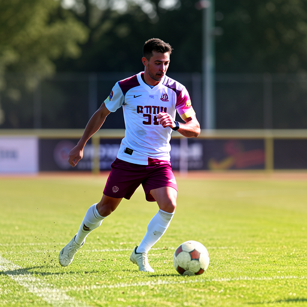

#### Without AI Director (1024x1024)
- **Generation Time:** `57.84s` (Step Rate: `14.461s/step`)
- **Peak Unified Memory:** `12.16 GB`
- **Prompt:** *Raw Direct Prompt*

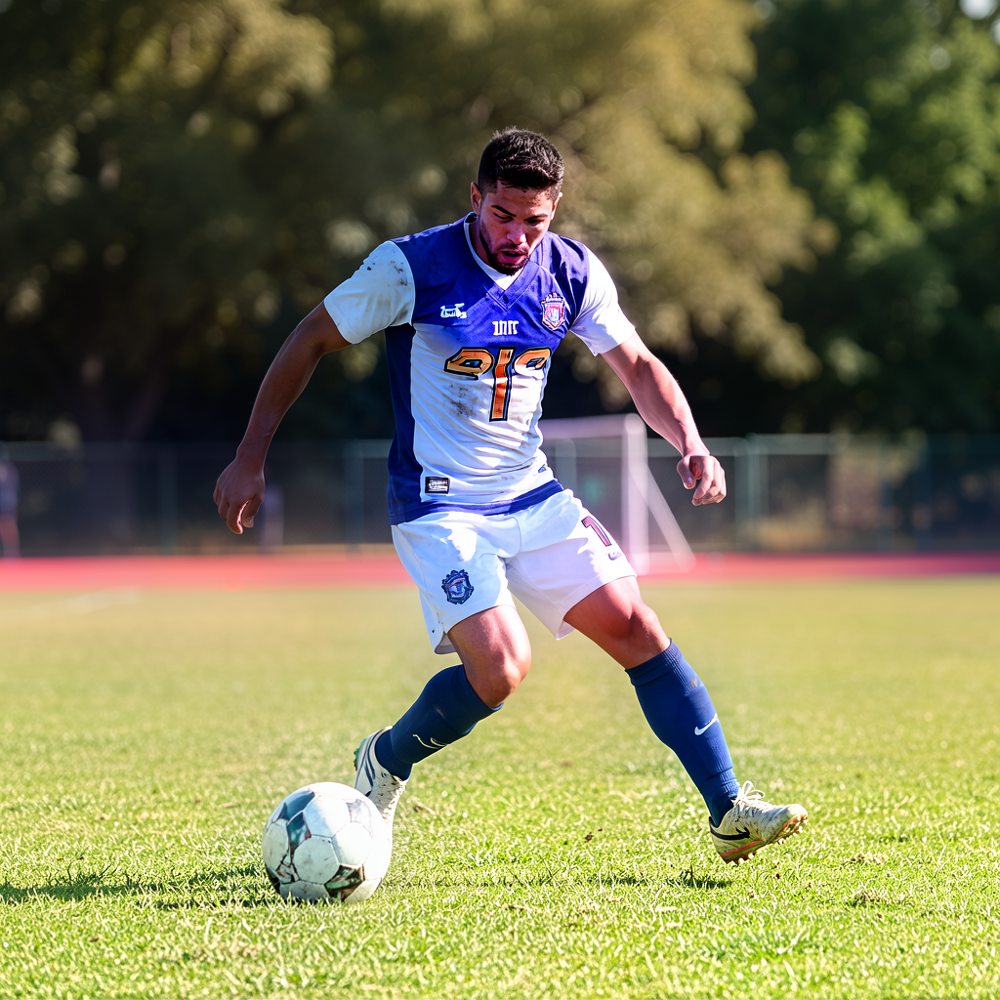

---

### 3. Z-Image Turbo (8-bit Affine)

- **Hugging Face Repository:** `justintime47/Z-Image-Turbo-MLX-Serve-8bit`

#### With AI Director (512x512)
- **Generation Time:** `10.32s` (Step Rate: `2.580s/step`)
- **Peak Unified Memory:** `16.17 GB`
- **AI Visual Director Expanded Prompt:**
  > "Hyperrealistic shot of a determined football player mid-action on a vibrant green stadium field, golden hour sunlight casting long shadows, dust motes dancing in the warm, directional rim lighting. Intense focus, dynamic low-angle composition, cinematic depth of field."

#### With AI Director (1024x1024)
- **Generation Time:** `47.22s` (Step Rate: `11.805s/step`)
- **Peak Unified Memory:** `25.93 GB`
- **AI Visual Director Expanded Prompt:**
  > "Hyperrealistic photograph of a determined football player mid-action on a lush, sun-drenched green field. Golden hour sunlight casts long shadows, highlighting sweat and focused intensity on his face. Dust motes dance in the warm, directional backlight. Shallow depth of field, cinematic wide shot."

#### Without AI Director (512x512)
- **Generation Time:** `11.69s` (Step Rate: `2.923s/step`)
- **Peak Unified Memory:** `16.17 GB`
- **Prompt:** *Raw Direct Prompt*

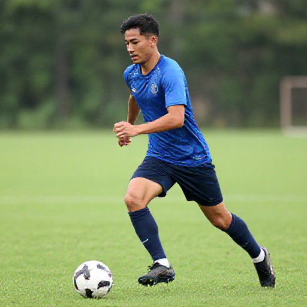

#### Without AI Director (1024x1024)
- **Generation Time:** `47.69s` (Step Rate: `11.922s/step`)
- **Peak Unified Memory:** `25.93 GB`
- **Prompt:** *Raw Direct Prompt*

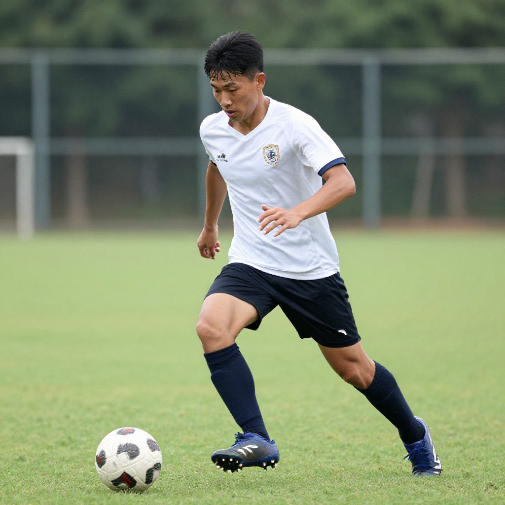

---

### 4. FLUX.2 Klein 4B (Unquantized BF16)

- **Hugging Face Repository:** `black-forest-labs/FLUX.2-klein-4B`

#### With AI Director (512x512)
- **Generation Time:** `7.41s` (Step Rate: `1.853s/step`)
- **Peak Unified Memory:** `14.12 GB`
- **AI Visual Director Expanded Prompt:**
  > "Sweat-soaked professional football player mid-action on a vibrant green grass field, dramatic golden hour sunlight casting long shadows, dust motes catching the warm rim lighting. Intense focus, gritty texture, shallow depth of field, ultra-realistic, cinematic shot."

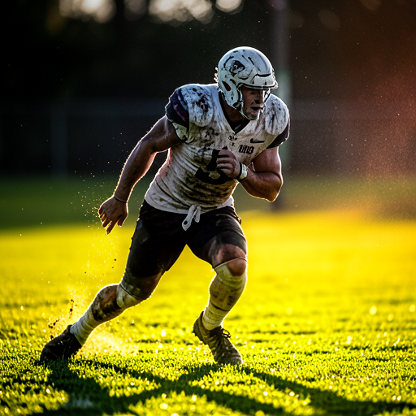

#### With AI Director (1024x1024)
- **Generation Time:** `27.87s` (Step Rate: `6.969s/step`)
- **Peak Unified Memory:** `19.44 GB`
- **AI Visual Director Expanded Prompt:**
  > "Hyperrealistic action shot of a determined football player mid-stride on a lush, sun-drenched green field. Golden hour sunlight casts long shadows, highlighting sweat and focused intensity on his face. Dynamic low-angle composition, shallow depth of field, cinematic grading, ultra-detailed, 8k."

#### Without AI Director (512x512)
- **Generation Time:** `6.45s` (Step Rate: `1.613s/step`)
- **Peak Unified Memory:** `19.29 GB`
- **Prompt:** *Raw Direct Prompt*

#### Without AI Director (1024x1024)
- **Generation Time:** `27.46s` (Step Rate: `6.866s/step`)
- **Peak Unified Memory:** `14.53 GB`
- **Prompt:** *Raw Direct Prompt*

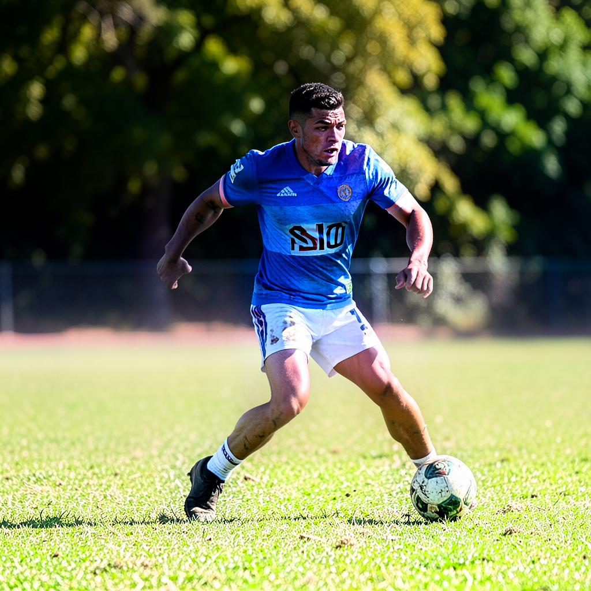

---

### 5. Qwen-Image 2.1 Turbo (4-bit Affine — 8 Steps)

- **Hugging Face Repository:** `OsaurusAI/Qwen-Image-2.1-Turbo-mflux-4bit`
- **Architecture:** Distilled 8-step `qwen_turbo` non-uniform sigma scheduler (`use_terminal=False`) paired with the Qwen3-VL 8B multimodal encoder. Fits in **9.43 GB** unified memory (~4.7x faster than the 40-step Base model).

#### With AI Director (512x512)
- **Generation Time:** `20.81s` (Step Rate: `2.601s/step`)
- **Peak Unified Memory:** `9.43 GB`
- **AI Visual Director Expanded Prompt:**
  > "Photorealistic, dynamic shot of a male football player mid-action on a sun-drenched, grassy field. Golden hour lighting casts long shadows. Intense focus, sweat glistening, vibrant green and earthy brown tones. Wide-angle, shallow depth of field."

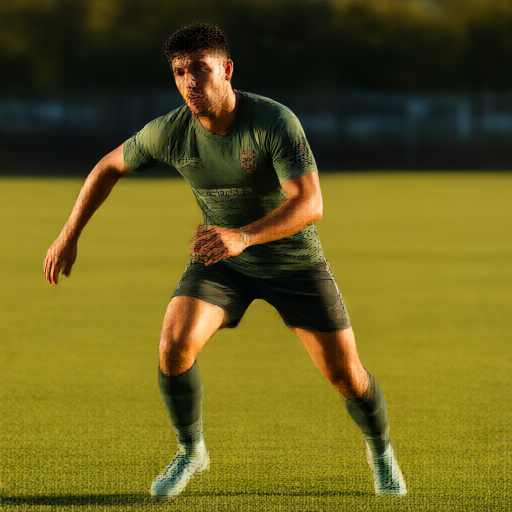

#### With AI Director (1024x1024)
- **Generation Time:** `96.49s` (Step Rate: `12.061s/step`)
- **Peak Unified Memory:** `9.43 GB`
- **AI Visual Director Expanded Prompt:**
  > "Photorealistic, dynamic shot of a male football player mid-action on a sun-drenched, grassy field. Golden hour lighting casts long shadows. Intense focus, sweat glistening, vibrant green and earthy brown tones. Wide-angle, shallow depth of field."

#### Without AI Director (512x512)
- **Generation Time:** `32.66s` (Step Rate: `4.082s/step`)
- **Peak Unified Memory:** `9.43 GB`
- **Prompt:** *Raw Direct Prompt*

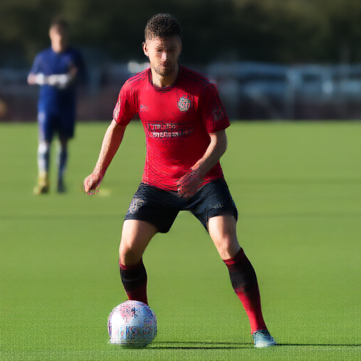

#### Without AI Director (1024x1024)
- **Generation Time:** `99.11s` (Step Rate: `12.388s/step`)
- **Peak Unified Memory:** `9.43 GB`
- **Prompt:** *Raw Direct Prompt*

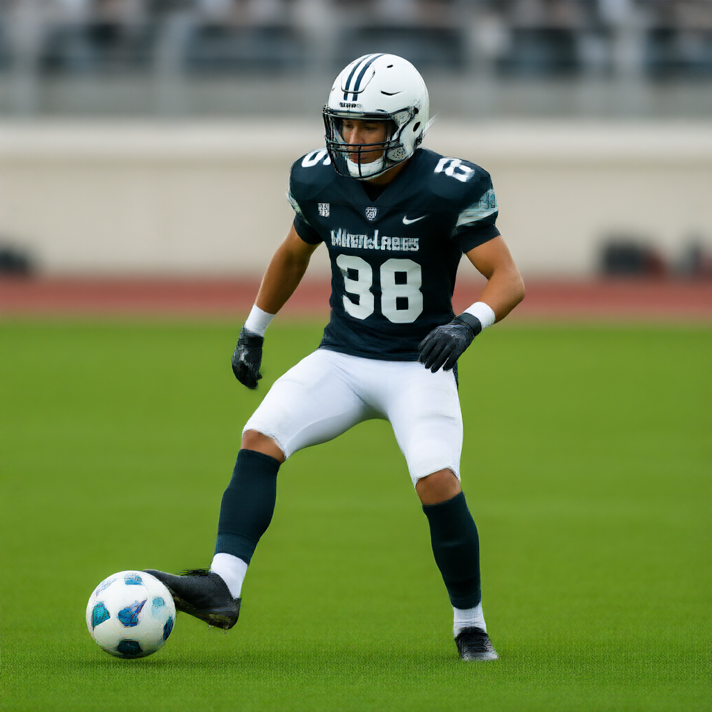

---

### 6. Qwen-Image 2.1 Base (4-bit Affine — 40 Steps)

- **Hugging Face Repository:** `mlx-community/Qwen-Image-2.1-MLX-4bit`
- **Architecture:** Undistilled 40-step linear flow-matching pipeline. Delivers ultra-crisp micro-textures (grass blades, skin pores, jersey fabric weave, and stadium bokeh) in **9.43 GB** unified memory.

#### With AI Director (512x512)
- **Generation Time:** `99.92s` (Step Rate: `2.498s/step`)
- **Peak Unified Memory:** `9.43 GB`
- **AI Visual Director Expanded Prompt:**
  > "Photo-realistic, dynamic shot of a male football player mid-action, intense focus, sweat glistening under bright afternoon sun, vibrant green grass, blurred background of spectators, high-speed motion, cinematic, sharp focus, natural skin tones."

#### With AI Director (1024x1024)
- **Generation Time:** `451.56s` (Step Rate: `11.289s/step`)
- **Peak Unified Memory:** `9.43 GB`
- **AI Visual Director Expanded Prompt:**
  > "Photo-realistic, dynamic shot of a male football player mid-action, intense focus, sweat glistening under bright afternoon sun, vibrant green grass, blurred background of spectators, high-speed motion, cinematic, sharp focus, natural skin tones."

#### Without AI Director (512x512)
- **Generation Time:** `107.03s` (Step Rate: `2.676s/step`)
- **Peak Unified Memory:** `9.43 GB`
- **Prompt:** *Raw Direct Prompt*

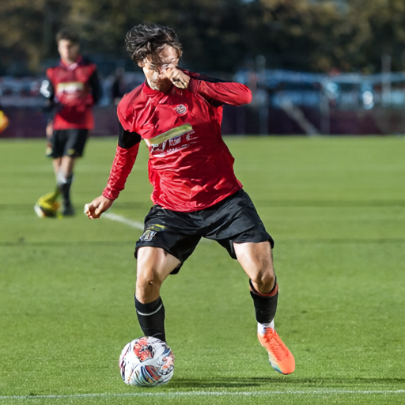

#### Without AI Director (1024x1024)
- **Generation Time:** `455.90s` (Step Rate: `11.398s/step`)
- **Peak Unified Memory:** `9.43 GB`
- **Prompt:** *Raw Direct Prompt*

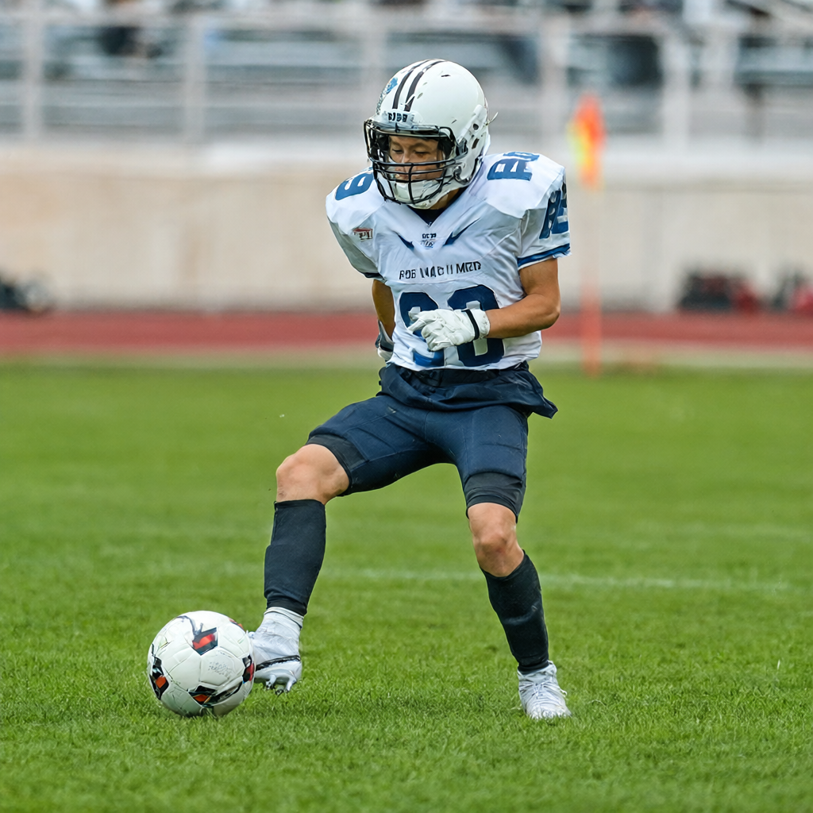

---

## Phase 2: Instruction-Based Image Editing Benchmark (`1024x1024`)

To evaluate instruction-guided image modification (`POST /v1/images/edits`), we took the `1024x1024` reference image ([`qwen21_turbo_4bit_with_director_1024.png`](images/qwen21_turbo_4bit_with_director_1024.png)) and applied the exact same multi-part modification instruction across all three edit-capable models with fixed seed `42`:

- **Edit Instruction:**
  > *"Change the stadium weather to heavy falling snow, add frost on the grass, and make the football a bright orange winter ball"*

### Editing Telemetry & Comparison Table

| Model | Checkpoint ID | Steps | Edit Time | Step Time | Peak RAM / VRAM | Pose & Identity Preservation | Environmental Transformation | Generated Output |
| :--- | :--- | :---: | :---: | :---: | :---: | :---: | :---: | :--- |
| **Qwen-Image 2.1 Turbo (4-bit)** | `OsaurusAI/Qwen-Image-2.1-Turbo-mflux-4bit` | `8` | **123.02s** | `15.38s` | **10.26 GB** | **Near-Exact** (strict pixel/pose lock) | Moderate (bright orange ball + frosted turf; conservative sky change) | [`edit_bench_qwen21_turbo_1024.png`](images/edit_bench_qwen21_turbo_1024.png) |
| **FLUX.2 Klein 9B (4-bit)** | `mlx-community/flux2-klein-9b-4bit` | `4` | **219.81s** | `54.95s` | **9.56 GB** | **High** (preserves exact pose, face, and kit) | **Exceptional** (full blizzard, snow accumulation on hair/arms/turf, glowing orange winter ball) | [`edit_bench_flux2_klein_9b_1024.png`](images/edit_bench_flux2_klein_9b_1024.png) |
| **Qwen-Image 2.1 Base (4-bit)** | `mlx-community/Qwen-Image-2.1-MLX-4bit` | `40` | **524.75s** | `13.12s` | **10.26 GB** | **Near-Exact** (strict pixel/pose lock) | Moderate-High (orange ball, frosted turf, denser snowfall in sky) | [`edit_bench_qwen21_base_1024.png`](images/edit_bench_qwen21_base_1024.png) |

#### 1. FLUX.2 Klein 9B (4-bit) — 4 Steps (`219.81s`, `9.56 GB` VRAM)
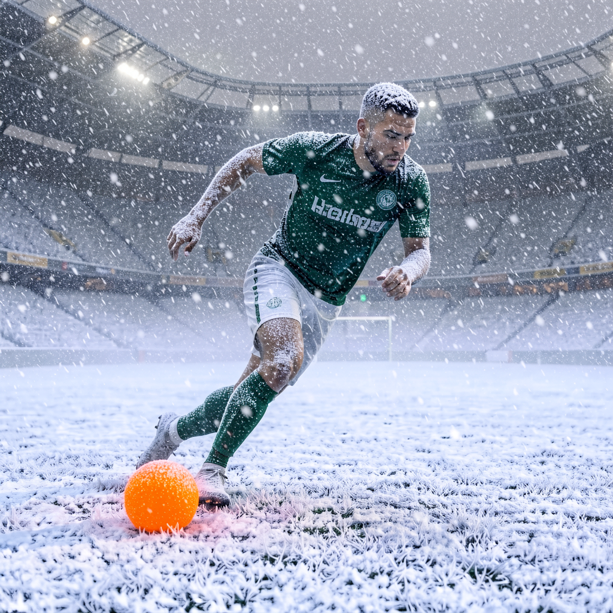

#### 2. Qwen-Image 2.1 Turbo (4-bit) — 8 Steps (`123.02s`, `10.26 GB` VRAM)

#### 3. Qwen-Image 2.1 Base (4-bit) — 40 Steps (`524.75s`, `10.26 GB` VRAM)

---

## Key Observations & Insights

1. **Speed Champion (Text-to-Image)**:
   - **`FLUX.2 Klein 4B (Unquantized BF16)`** remains the fastest generator overall: **`6.45s`** at `512x512` and **`27.46s`** at `1024x1024` (4 steps).
2. **Memory Efficiency Leaders**:
   - **`Bonsai 4B (2-bit Ternary)`** (`8.21–8.57 GB`) and **`Qwen-Image 2.1 (4-bit Turbo & Base)`** (`9.43 GB` for generation, `10.26 GB` for editing) achieve the lowest unified memory footprints across all resolutions, never exceeding `10.3 GB` even at `1024x1024`.
3. **Qwen-Image 2.1 Turbo (8-Step) vs. Base (40-Step)**:
   - **Turbo (`OsaurusAI/Qwen-Image-2.1-Turbo-mflux-4bit`)** is **4.7x faster** than Base (`20.81s` vs `99.92s` at `512x512`; `96.49s` vs `451.56s` at `1024x1024`) with identical `9.43 GB` memory usage.
   - **Base (`mlx-community/Qwen-Image-2.1-MLX-4bit`)** rewards its 40-step schedule with noticeably sharper micro-detail on skin pores, sweat droplets, and fabric folds when paired with the AI Visual Director.
4. **Instruction-Based Editing Showdown (`Qwen-Image 2.1` vs `FLUX.2 Klein 9B`)**:
   - **`Qwen-Image 2.1 Turbo`** is the **fastest editor (`123.02s` at `1024x1024`)** and exhibits the strictest structural preservation—locking every pixel of the subject's silhouette while recoloring the ball bright orange and frosting the grass.
   - **`FLUX.2 Klein 9B (4-bit)`** (`219.81s` at `1024x1024`) delivers the most dramatic, holistic scene relighting—transforming the background into a snow-filled stadium, adding realistic snow accumulation onto the player's hair, eyebrows, and forearms, and rendering a glowing orange winter ball while still keeping the player's exact pose and identity intact.
5. **AI Visual Director Impact**:
   - Beyond enriching lighting and camera optics, the **AI Visual Director** resolved semantic ambiguity in `Qwen-Image 2.1`—turning a confused American-football-helmet + soccer-ball hybrid in Direct Mode into an anatomically and contextually accurate sports photograph.